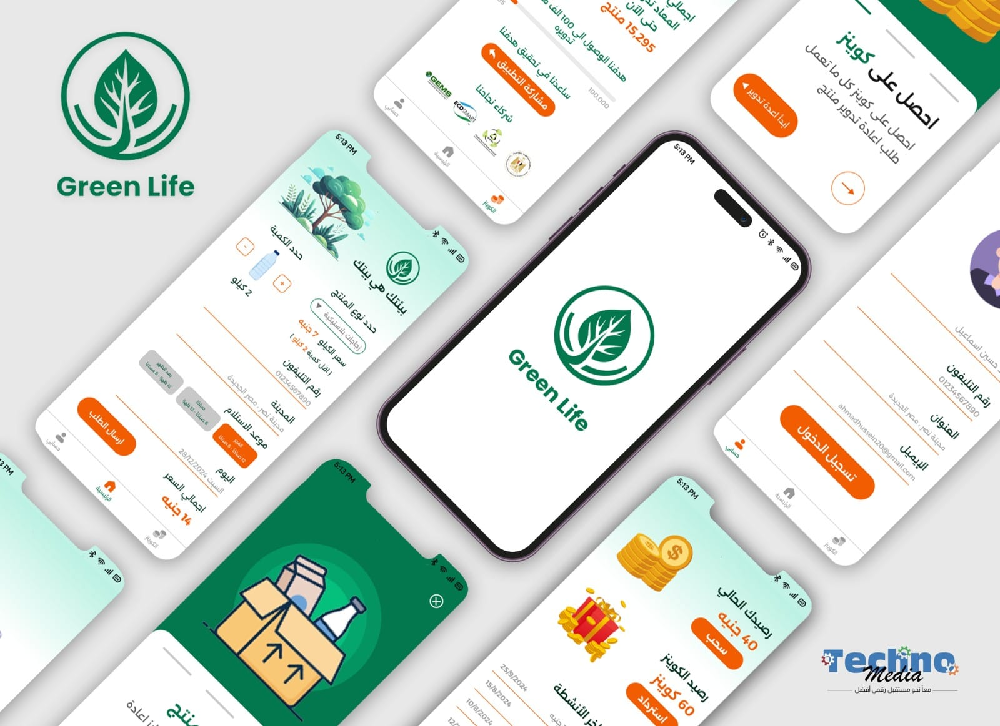

# Green Life — Recycling App UI/UX

An Arabic-first mobile app concept designed by **Angelo Rezq** that turns recycling into a rewarding habit: schedule a pickup for recyclable materials, earn coins ("كوينز") for every kilogram, and watch your environmental impact grow.

## The idea

Green Life connects households with recycling collectors. You place an order for what you have (cartons, used oil, plastics, jerrycans), a pickup gets scheduled, and the weight you hand over is converted into coins you can redeem. The more you recycle, the more you earn.

## What's inside

- **Onboarding & auth** — splash, walkthrough, sign-in, and OTP verification.
- **Home & orders** — place a recycling order by material type and quantity.
- **Coins wallet** — your balance in Egyptian pounds, earned from recycled weight.
- **Sales statistics** — a personal dashboard with product breakdowns, totals, and a full activity history table.
- **Design process** — from hand-drawn wireframes to the final high-fidelity mockup.

## Design process

The flow was sketched on paper first — splash, onboarding, login, OTP, then home — before moving to high-fidelity screens.

| Hand-drawn wireframe | Final mockup |
|---|---|
|  |  |

## Screens

Individual screens are in [`/screens`](./screens): splash and onboarding, sign-in, OTP verification, ordering, the coins wallet, sales statistics with partner organizations, and the account area.

## Author

**Angelo Rezq** — concept and UI/UX design.
